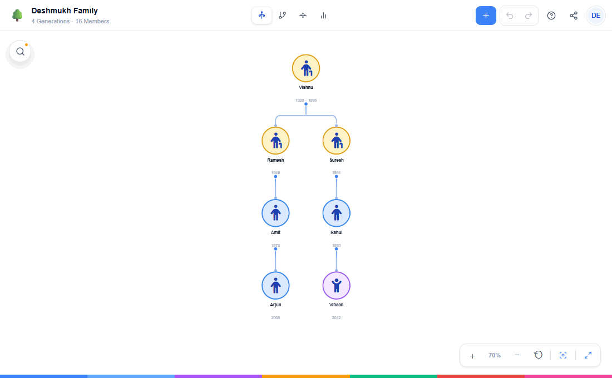
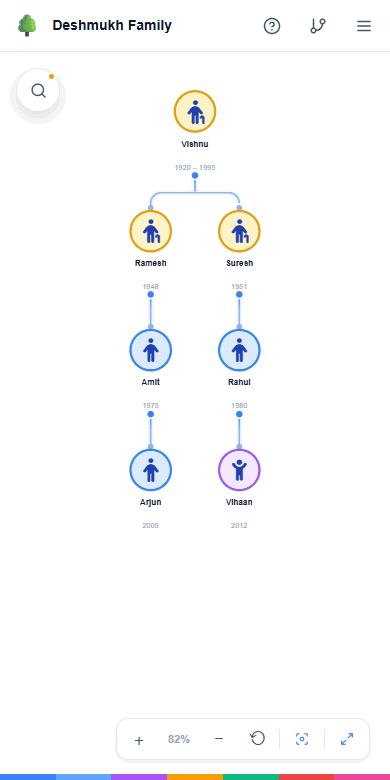

# FamilyTree

An interactive family tree in English and Marathi, published on GitHub Pages at https://p23ghodake.github.io/FamilyTree/. Anyone can browse; approved family editors sign in to add and update members, and changes are saved to the separate `p23ghodake/FamilyTree-Data` repository by default.

## Features

- **Header:** switch between **Tree**, **Trace** (find how two people are related), **Timeline** and **Statistics**. Editors also get **Add member**, **Undo** and **Redo**. Language, theme, avatar style, the guided tour and admin tools are in the settings menu. On phones, Trace stays in the top bar and the rest move into a ☰ menu that opens from the bottom. The layout uses the visible screen height, so the zoom controls and bottom pop-ups are not hidden behind phone browser toolbars.
- **Sibling order:** brothers and sisters appear left to right as sons first, then daughters, each eldest first. Siblings without a birth year come last in their group, in the order they were entered. Spouses stay beside their partner.
- **Poster (admin):** a downloadable family-tree poster that follows the blood line through the sons. Only men can be chosen as the starting person; the **Find a starting person** field combines name search and selection in one keyboard-navigable picker, with a father's name added to disambiguate duplicate first names. A man's tag lists his wives, joined by small heart markers, except divorced or separated ones. Daughters appear alone, without their husbands or children. A wife's children from another marriage are still shown. Branch thickness follows the size of the family it carries. A compact, theme-matched toolbar places **Family** and **Appearance** settings between the poster title and the download/close buttons on larger screens, leaving the full preview width free. On tablets, phones and short landscape screens, **Customize** expands the same settings directly below the title and actions; **Done** or Escape collapses them. Settings scroll within their own area when space is limited, without covering the poster. **Style** is a dropdown listing Autumn, Spring blossom, Summer and Banyan (with hanging roots), without preview illustrations. **Name style** switches between the original **Heritage script** and **Readable** fonts. Each person's complete name stays on a single line at the chosen font size, without wrapping, truncation or squeezed letters. Cards widen and spacing adjusts for longer names, script overhang, tall accents and intact Marathi conjuncts so tags do not overlap. The poster uses name-only tags and a clean paper background, without life-year labels or aged-paper effects. A floating zoom bar inside the bottom-right of the preview shows the current percentage: **Fit** shows the whole poster, **Reset to 100% view** returns to actual size, and **−**, **+**, **Ctrl/⌘ + scroll** and a two-finger pinch zoom in and out. All poster action buttons are icon-only, with localized tooltips and accessible names; picker names and the zoom percentage remain visible. PNG downloads retain the full artwork, without the editor controls.
- **Search and filters:** the round search button (or the `/` key) opens a compact search bar. Its filter button offers **Living only**, **Hide females**, **Marriage eligible** and a location filter. **Hide females is on by default**; **Clear** turns every filter off.
- **Tree lines:** the admin chooses how the lines between parents and children look for everyone: **Static** (the original lines), **Energy pulse** (one glowing bead per line) or **Light particle flow** (a steady stream of dots), and the **line shape**: **Elbow** (right-angled lines with rounded corners, as before) or **Curved** (smooth S-curves from parents to each child). For the animated styles the admin also sets the **speed** (slow, normal or fast) and **pulse timing** (*Cascade*, one generation after another, or *Together*). Animation starts at the oldest living members of each branch; lines below couples who have both died stay static. Visitors whose device asks for reduced motion, printouts and PNG exports always get the static lines. The choice is stored as `settings` in the shared family data file, so it applies as soon as it is saved, without redeploying the site.
- **Member details:** clicking or tapping a person opens a compact life-timeline panel for everyone, including visitors. The header shows a 42px avatar, full name, generation, age, occupation and location. Below it, a year rail lists birth (with parents), marriages (former spouses marked), children and death in date order, followed by notes. Relatives are clickable. Colours follow the selected theme. Editing remains restricted to approved editors.
  The panel uses the selected language's labels and available names, without an alternate-language name. Long content is divided into compact Previous/Next pages rather than a scrolling panel. Free-text notes, occupation, and location remain as entered.
- **Add and edit members:** a step-by-step form: **Relationship** (child, spouse, parent or not linked, with a searchable list of people), then **Who** (photo, names, gender), then **Dates & details** (all optional). The Marathi name is filled in automatically and can be edited. When adding a child or spouse from a person's menu, the relationship step is skipped. When editing, any step can be opened and saved directly. Uploaded photos are resized to 400 px JPEGs. Turn off **Living** to record a death even when its date is unknown; this is saved as the optional `isDeceased` flag. Older records still infer deceased status from a death year or date. Year-only and year/month dates are supported, but impossible calendar dates and death dates definitely before birth are rejected. An unknown death year does not produce an estimated current age.
- **Sign in:** choose **Continue with GitHub** or **Continue with email**. Errors are shown inside the form, with a Caps Lock warning on the password field.
- **Accessibility:** dialogs trap keyboard focus, close with Escape and return focus to where you were. The tree can be panned with arrow keys when its viewport is focused. All text is available in English and Marathi.

## Demo

The recordings below use a fictional family (the Deshmukhs) and a demo editor account; no real family data is shown.

| Tree, zoom and person details | Search and filters |
|---|---|
|  |  |
| **Trace a relationship** | **Add a member** |
|  |  |
| **English ↔ Marathi** | **Phone layout** |
|  |  |

## Roles and permissions

| Who | Browse | Add / edit members | Delete members | Reset shared data | Export JSON / PNG, Print | Tree line style |
|---|---|---|---|---|---|---|
| Guest (not signed in) | Limited live data | – | – | – | – | – |
| Read-only user (`READONLY_GITHUB_USERS`) | Live data | – | – | – | – | – |
| Editor (`ALLOWED_GITHUB_USERS`) | Live data | ✓ | – | – | – | – |
| Admin signed in with email/password | Live data | ✓ | – | – | ✓ | ✓ |
| Admin signed in **with GitHub** | Live data | ✓ | ✓ | ✓ | ✓ | ✓ |

Admin identities are configured only in the Edge Function's `ADMIN_USERS` secret. They must also be listed in `ALLOWED_GITHUB_USERS` to edit. **Deleting members requires an admin session signed in through GitHub**; email/password sessions cannot delete. The Reset/reload control is also shown only to an admin signed in with GitHub. The Edge Function enforces the deletion restriction by comparing each save with the current file on GitHub. Undoing an add counts as a removal, so only an admin can do it.

The **tree line style** (Settings → Admin → *Tree lines*) can be changed by either admin identity, with GitHub or email/password sign-in. Each change is saved to GitHub straight away. The Edge Function rejects any save that changes `settings` unless it comes from an admin, and editors' member saves keep the admin's settings unchanged. After updating, redeploy the function (`npx supabase functions deploy family-data`) so the server check is active.

The frontend receives the current user's admin and delete capabilities from the Edge Function; no admin email or identity list is embedded in the public app. Set `ADMIN_USERS` as a required Edge Function secret containing comma-separated GitHub usernames or confirmed GitHub emails. There is no built-in admin fallback.

## GitHub-backed family data

By default, family data is the root file `g_familyData.json` in `p23ghodake/FamilyTree-Data`, not a bundled file in this application repository. Ensure that repository and its valid family-data JSON file exist before deploying. The React app calls the `family-data` Edge Function for everyone; approved users receive full data and visitors receive a read-only view without exact birth dates. Editors authenticate with Supabase, and the function uses a server-side fine-grained GitHub token to read or update the file through the GitHub Contents API. No family-data database/table is used.

### Supabase and GitHub setup

1. Create a Supabase project. In **Authentication → Providers → GitHub**, enable GitHub and enter a GitHub OAuth App client ID and client secret. In the OAuth App, set its callback URL to `https://<project-ref>.supabase.co/auth/v1/callback`.
2. In Supabase **Authentication → URL Configuration**, allow the production redirect `https://p23ghodake.github.io/FamilyTree/` and local redirect `http://localhost:5173/`.
3. Create a GitHub fine-grained personal access token restricted to `p23ghodake/FamilyTree-Data`, with **Contents: Read and write** only. If you override `DATA_REPO`, scope the token to that data repository instead. Do not put it in React `.env` files or GitHub Pages variables.
4. Add the token as the Edge Function secret named `GITHUB_TOKEN` in Supabase **Project Settings → Edge Functions → Secrets**, or create an untracked `supabase/.env` containing `GITHUB_TOKEN=<token>` and run `supabase secrets set --env-file supabase/.env`. This file is ignored by Git and is not a React environment file. Supabase supplies `SUPABASE_URL` and `SUPABASE_ANON_KEY` to the function.
5. Copy the Supabase project URL and browser-safe anon/publishable key into a local `.env` file using `.env.example` as a template. The `VITE_` values are public browser configuration, not secrets.
6. In the GitHub repository's **Settings → Secrets and variables → Actions → Variables**, define `VITE_SUPABASE_URL` and `VITE_SUPABASE_ANON_KEY` with those same public values. The Pages workflow injects them at build time.

No Supabase database, table, service-role key, or GitHub token is needed by the frontend.

### Deploy the Edge Function

Install the Supabase CLI, then authenticate, link the project, and deploy:

```sh
npx supabase login
npx supabase link --project-ref <project-ref>
npx supabase functions deploy family-data
```

Set the `ALLOWED_GITHUB_USERS` Edge Function secret to a comma-separated list of GitHub usernames allowed to read/write data (for example `npx supabase secrets set ALLOWED_GITHUB_USERS=user1,user2`); other signed-in users receive the limited view and get a 403 if they try to save. Entries may be GitHub usernames or confirmed emails for email/password users. Set `ADMIN_USERS` to the admin GitHub usernames or confirmed emails; include each admin in `ALLOWED_GITHUB_USERS` as well. Optionally set `READONLY_GITHUB_USERS` for users who can load data but not save changes.

Authorization uses the verified GitHub provider identity or a confirmed email, not editable user metadata. The sign-in method used for delete and reset permissions is read from the validated access token. Redeploy the `family-data` Edge Function after updating its authorization code:

```sh
npx supabase functions deploy family-data --project-ref <project-ref>
```

Set or update the `GITHUB_TOKEN` and `ADMIN_USERS` Edge Function secrets in the Supabase Dashboard, or use the ignored `supabase/.env` method above. The function keeps JWT verification enabled; it also validates each access token with Supabase Auth. Its default Contents API target is `g_familyData.json` in `p23ghodake/FamilyTree-Data`. Optional Edge Function secrets `DATA_REPO` (repository name under `p23ghodake`) and `DATA_FILE_PATH` (path within that repository) override these defaults; the GitHub token must have access to the chosen repository. Calendar-date and chronological-order validation also runs before the function saves a file; redeploy it when updating this validation.

### Reset

The Reset control is shown only to the admin signed in with GitHub who has edit access. After explicit confirmation, it reloads the currently saved GitHub data and clears local undo/redo history. It does not write to GitHub or replace the data with a bundled dataset. Data-changing controls remain locked until the current save finishes.

### GitHub Pages deployment

Set the two Actions **variables** described above, then push to `main` or run the Pages workflow. For local development, copy `.env.example` to `.env`, fill in the public Supabase URL and key, and run:

```sh
npm ci
npm run dev
```

The app is built with Vite into `build/`; the Pages workflow runs tests before building and deploying.

## Tests

```sh
npm test
```

On Windows, run the test and type-check tools directly if needed:

```sh
node node_modules/typescript/bin/tsc --noEmit
node node_modules/jest/bin/jest.js --ci --runInBand
```

Main test files: `src/components/functional.test.tsx`, `src/components/ux.test.tsx`, `src/components/persistence.test.tsx`, `src/components/TreeView/MarriageHistorySection.test.tsx`, `src/context/FamilyTreeContext.test.tsx`, `src/context/LanguageContext.test.tsx`, `src/services/familyDataValidation.test.ts` and the `src/processing/*.test.ts` files. The persistence tests mock Supabase responses, and the server-write tests execute the Edge Function handler with mocked HTTP requests; neither contacts production services.
